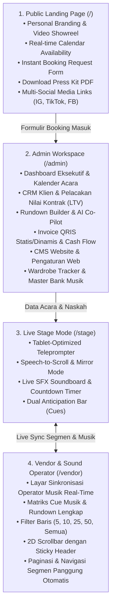
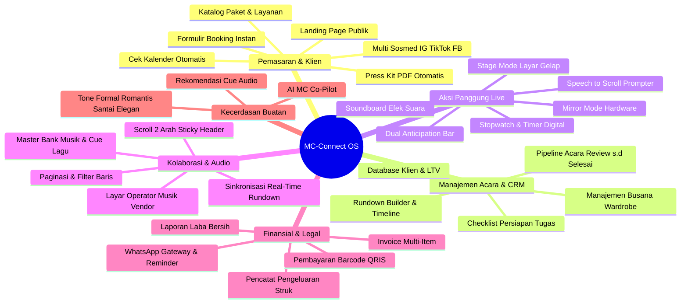

# Dokumentasi Modul, Fitur & Keunggulan Aplikasi MC-Connect

> **MC-Connect** adalah platform *All-in-One Operating System* yang dirancang khusus untuk profesi **Master of Ceremony (MC), Event Host, Moderator, dan Entertainer Profesional**. Berbeda dari website portofolio biasa, MC-Connect mengintegrasikan fungsi **Marketing (CMS Landing Page)**, **Operasional Bisnis (CRM & Keuangan)**, **Asisten Panggung (Stage Mode & Teleprompter)**, hingga **Kolaborasi Vendor Lapangan (Sound & WO)** ke dalam satu ekosistem terpadu.

---

## 1. Arsitektur 4 Portal Utama

Aplikasi ini dibagi menjadi 4 antarmuka utama yang saling terhubung secara *real-time*:

---

## 2. Pemetaan Menu Sidebar Admin Workspace (`/admin`)

Antarmuka Admin dilengkapi 8 modul menu utama:

| No | Menu Sidebar | Ikon | Deskripsi Fungsional |
| :---: | :--- | :---: | :--- |
| **1** | **Dashboard** | 📊 | Ringkasan metrik eksekutif, pendapatan terkunci, rasio konversi booking, tren pendapatan bulanan, dan jadwal terdekat. |
| **2** | **Kalender Acara** | 📅 | Kalender pemantauan anti-bentrok, deteksi bentrok real-time, badge ketersediaan (Available, Tentative, Terkunci), dan aksi responsif mobile. |
| **3** | **Data Pelanggan** | 👥 | Direktori CRM klien, riwayat acara, nilai total kontrak (*LTV*), kategori klien (VIP, Korporat, Regular, WO), dan pencarian instan. |
| **4** | **Cash Flow** | 💰 | Pencatatan pemasukan & pengeluaran acara, validasi angka bersih (tanpa minus), bukti struk transaksi, dan laporan laba bersih. |
| **5a**| **Pengaturan > CMS Konten** | ⚙️ | Pengaturan profil MC, bio panggung, foto avatar, sosmed (IG, TikTok, Facebook), katalog paket harga, event riders, dan galeri portofolio. |
| **5b**| **Pengaturan > Pengaturan Web** | ⚙️ | Rekening penerima, upload QRIS statis resmi bisnis, kelola kategori acara & klien, template WhatsApp, dan keamanan ganti password. |
| **6** | **Event Command Center** | ⚡ | Pusat kendali per acara: Status tagihan QRIS, Expense tracker, Catatan VIP & Protokoler, Rundown timeline, AI Co-Pilot, dan WA gateway. |
| **7** | **Wardrobe Tracker** | 👔 | Katalog digital busana MC (jas, kebaya, tuxedo, batik), tracking status cuci/siap, dan pemetaan busana per acara. |
| **8** | **Master Bank Musik** | 📁 | Repositori audio background & efek suara (BGM, Fanfare, Romance, Games) berbasis Web Audio API offline-ready. |

---

## 3. Rincian Modul & Fitur Lengkap

### 🌟 Modul 1: Public Branding & Instant Booking Portal (`/`)
* **Live Calendar Availability**: Klien publik dapat mengecek tanggal ketersediaan jadwal MC secara langsung (*Available*, *Booked*, atau *Tentative*) tanpa perlu konfirmasi manual berulang kali.
* **Instant Booking Engine**: Formulir pemesanan langsung yang otomatis mencatat calon klien ke database server dengan status *Tentative* dan memicu draft invoice.
* **Dynamic Media Showreel**: Pemutar video showreel YouTube terintegrasi dan kurasi galeri foto beresolusi tinggi dengan sistem upload banyak foto sekaligus.
* **Paket Layanan & Riders**: Menampilkan paket harga panggung dan *hospitality & technical riders* secara transparan dan profesional.
* **Integrasi Akun Media Sosial**: Tautan resmi ke akun Instagram, TikTok, dan Facebook MC dengan logo resmi dan dukungan tautan responsif.
* **One-Click Press Kit PDF**: Pengunjung atau instansi dapat langsung mengunduh profil resmi MC dalam format PDF elegan yang di-*generate* dinamis dari database.

---

### 💼 Modul 2: Admin Dashboard & CRM Klien
* **Dashboard Metrik Kinerja**: Ringkasan performa finansial (Total Omset Terkunci, Total Acara, DP Tertunda, Margin Keuntungan Bersih).
* **Grafik Tren Pendapatan Interaktif**: Visualisasi grafik area chart bulanan untuk memantau performa bisnis kuartal berjalan.
* **Manajemen Pipeline Acara**: Pelacakan status acara multi-tahap: `Review` $\rightarrow$ `Tentative` (dengan auto-cleanup batas 24 jam) $\rightarrow$ `Terkunci` (setelah DP) $\rightarrow$ `Selesai`.
* **CRM Klien & LTV (Lifetime Value)**:
  - Database klien lengkap dengan riwayat booking, total omset per klien (*LTV*), dan kategori klien kustom.
  - Catatan khusus preferensi klien dan riwayat kontak.

---

### 🤖 Modul 3: AI MC Co-Pilot (Script & Cue Generator)
* **Penyusun Naskah Otomatis**: Menghasilkan naskah panggung per segmen acara (*Opening, Grand Entrance, Cake Cutting & Toast, Dinner, Games, Closing*).
* **4 Pilihan Gaya Bicara (Tone of Voice)**:
  - `Formal`: Anggun, berwibawa, dan protokoler kenegaraan/korporat.
  - `Romantic & Warm`: Hangat, syahdu, dan puitis untuk resepsi pernikahan.
  - `Energetic & Fun`: Dinamis, ceria, dan interaktif untuk gathering/festival.
  - `Elegant Luxury`: Mewah, eksklusif, dan berkelas untuk gala dinner.
* **Music Cue Automation**: Rekomendasi otomatis jenis lagu pendukung (*Audio Cue*) di setiap naskah segmen.
* **Sistem Kuota Token AI**: Manajemen kuota token yang fleksibel dan terlacak langsung pada akun MC.

---

### 🎙️ Modul 4: Live Stage Mode & Intelligent Teleprompter (`/stage`)
* **Tablet-First UI**: Antarmuka gelap kontras tinggi (*OLED-friendly*) dengan tombol navigasi raksasa (*Giant Nav Zone*) yang ramah sentuhan di atas panggung.
* **Speech-to-Scroll (Deteksi Suara)**: Teleprompter cerdas yang mendeteksi suara bicara MC via Web Speech API dan menggulirkan teks naskah secara otomatis mengikuti kecepatan berbicara.
* **Hardware Mirror Mode**: Membalikkan tampilan teks secara horizontal untuk kompatibilitas perangkat kaca teleprompter profesional (*beam splitter glass*).
* **Dual Stage Anticipation Bar**: Menampilkan segmen saat ini, segmen sebelumnya, serta mengintip (*peek preview*) segmen berikutnya lengkap dengan panduan waktu dan musik pendukung.
* **Live Soundboard SFX**: Tombol suara instan panggung (*Tepuk Tangan, Fanfare, Drumroll, Laughter, Game Buzzer*) yang diputar secara offline dengan latensi nol.
* **Stopwatch & Jam Panggung**: Indikator durasi panggung untuk memastikan acara berjalan tepat waktu (*on-time run*).

---

### 🎧 Modul 5: Sound & Vendor Operator Screen (`/vendor`)
* **Sinkronisasi Dua Arah (Live Sync)**: Layar operator sound/lighting secara otomatis menyorot dan mengikuti segmen aktif yang sedang diklik oleh MC di panggung.
* **Matriks Cue Musik Panggung**: Menampilkan urutan waktu, nama segmen, naskah ringkas, judul lagu yang melekat, intruksi khusus cue audio, serta PIC koordinator panggung.
* **Filter Jumlah Baris Fleksibel**: Pilihan filter tampilan (5 baris, 10 baris, 25 baris, 50 baris, atau Semua baris).
* **Navigasi & Scrollbar 2 Arah**: Dilengkapi container scroll vertikal & horizontal dengan *sticky header*, info total baris & halaman, tombol *Sebelumnya*/*Berikutnya*, dan fitur *auto-jump* ke halaman segmen aktif.
* **100% Offline Audio Player**: Tombol *Play/Stop* mandiri berbasis Web Audio API serta fitur *Unduh Seluruh Audio Pack (.wav)* untuk kehandalan tanpa jaringan internet.

---

### 💰 Modul 6: Invoicing, QRIS & Cashflow Management
* **Generator Invoice Resmi**: Pembuatan rincian invoice dinamis (*multi-line items*) lengkap dengan perhitungan DP dan sisa pelunasan otomatis.
* **Dukungan QRIS Statis & Dinamis**: Terintegrasi langsung dengan QRIS resmi bisnis yang diunggah di database server, serta fallback QRIS dinamis berbasis nomor invoice.
* **Pelacak Biaya & Bukti Pengeluaran (Expense Tracker)**:
  - Mencatat biaya operasional per acara (transportasi, wardrobe, asisten MC, akomodasi).
  - Fitur unggah bukti struk/kwitansi langsung dari galeri atau kamera HP.
* **Laporan Laba/Rugi Bersih**: Kalkulasi laba bersih riil (*Net Profit Margin*) setelah pendapatan dikurangi total pengeluaran per event.

---

### 👔 Modul 7: Wardrobe Tracker & Stylist Planner
* **Katalog Busana Digital**: Manajemen koleksi jas, kebaya, tuxedo, batik, dan gaun MC lengkap dengan foto, warna, dan jenis formalitas.
* **Event Wardrobe Mapping**: Penjadwalan busana untuk setiap event guna mencegah penggunaan pakaian yang sama pada klien atau lingkaran tamu yang berdekatan.

---

### 💬 Modul 8: WhatsApp Communication Hub
* **Template Pesan Cerdas**: Template pesan WhatsApp dinamis dengan variabel otomatis:
  - `{name}`, `{event}`, `{mc_name}`, `{nominal_dp}`, `{link_invoice}`.
* **One-Click WhatsApp Gateway**: Mengirim pesan konfirmasi booking, reminder pelunasan, dan follow-up langsung ke WhatsApp klien tanpa perlu repot menyimpan nomor telepon.

---

### 🔄 Modul 9: Offline-First PWA & High Performance
* **Ketahanan Tanpa Internet (PWA)**: Dilengkapi `Service Worker` (`sw.js`). Jika koneksi internet terputus di dalam *ballroom* hotel atau area basement, aplikasi tetap dapat membaca naskah dan memutar audio panggung.
* **Arsitektur Database Server**: Seluruh mutasi data tersimpan aman dan terenkripsi di database MySQL server dengan sistem otentikasi session anti-bypass.

---

## 4. Keunggulan & Nilai Unik Aplikasi (Mengapa Aplikasi Ini Unggul?)

| No | Keunggulan Utama | Penjelasan Keunggulan |
| :---: | :--- | :--- |
| **1** | **Bukan Sekadar Portofolio, Melainkan OS Bisnis** | Website portofolio biasa hanya pajangan statis. MC-Connect adalah sistem operasi bisnis lengkap dari penerimaan pesanan, manajemen kontrak, asisten panggung, hingga pembukuan keuangan. |
| **2** | **Menghilangkan Insiden Panggung (*Zero Stage Blunder*)** | Berkat *Anticipation Bar* dan *Live Sync* ke operator musik, MC tidak akan lupa nama VIP, tidak akan salah membaca urutan agenda, dan operator musik tidak akan telat memutar lagu opening/fanfare. |
| **3** | **Teknologi Prompter Tercanggih di Kelasnya** | Fitur *Speech-to-Scroll*, *Mirroring*, kontrol hotkey keyboard, dan tombol navigasi sentuh ekstra besar memberikan kenyamanan setara teleprompter siaran televisi internasional. |
| **4** | **Efisiensi Waktu dengan AI Co-Pilot** | Menghemat waktu berjam-jam dalam merancang susunan kata (*scripting*) untuk rundown baru dengan memanfaatkan AI yang sudah di-*tuning* khusus untuk gaya kepribadian panggung MC. |
| **5** | **Citra Profesionalisme Ekstrem di Mata Klien** | Klien dimanjakan dengan invoice QRIS modern, jadwal kalender interaktif, dan *Press Kit* format PDF elegan yang siap unduh secara instan, meningkatkan daya tawar (*rate card*) MC. |
| **6** | **Aman & Anti-Macet di Lokasi Minim Sinyal** | Dengan arsitektur Service Worker offline dan audio sintetis lokal, MC tidak perlu khawatir jika lokasi pernikahan berada di gedung bawah tanah (*basement*) dengan sinyal seluler lemah. |

---

## 5. Diagram Ekosistem Fitur

