# Panduan Alur Proses Pemesanan & Checklist Testing Browser MC-Connect

> Dokumen ini adalah panduan operasional komprehensif yang berisi:
> 1. **Alur Proses Bisnis Hulu ke Hilir** (Dari klien pertama kali membuka web hingga acara selesai & tutup buku).
> 2. **Alur Skenario Uji Coba Terpadu** (Simulasi perjalanan pengguna secara berurutan).
> 3. **Master Checklist Testing Manual per Modul Fitur** (Daftar uji klik & input langsung di browser).

---

## BAGIAN 1: Alur Proses Bisnis Hulu ke Hilir (End-to-End User Journey)

```mermaid
flowchart TD
    subgraph Fase1["Fase 1: Hulu (Pemasaran & Request Booking)"]
        A1["1. Klien membuka Portal Publik (/)"] --> A2["2. Klien melihat Showreel, Paket & Riders"]
        A2 --> A3["3. Klien cek tanggal di Kalender Ketersediaan"]
        A3 --> A4["4. Klien klik tanggal hijau & isi Formulir Request to Book"]
    end

    subgraph Fase2["Fase 2: Manajemen Lead & Konfirmasi Finansial"]
        A4 --> B1["5. Notifikasi booking masuk di Dashboard & Kalender Admin"]
        B1 --> B2["6. Admin kirim pesan sapaan via WhatsApp Gateway (1-Klik)"]
        B2 --> B3["7. Admin terbitkan Invoice resmi dengan Kode QRIS Bisnis"]
        B3 --> B4["8. Klien bayar DP 50% via QRIS"]
        B4 --> B5["9. Admin set status DP Paid → Tanggal TERKUNCI (Anti-Bentrok)"]
    end

    subgraph Fase3["Fase 3: Pra-Acara (Persiapan & AI Scripting)"]
        B5 --> C1["10. Admin isi Checklist Persiapan Acara & Catatan VIP"]
        C1 --> C2["11. MC pilih busana di Wardrobe Tracker (Cegah Baju Dobel)"]
        C2 --> C3["12. AI MC Co-Pilot susun naskah panggung & rekomendasi cue audio"]
        C3 --> C4["13. Admin hubungkan lagu master dari Bank Musik ke Rundown"]
    end

    subgraph Fase4["Fase 4: Hari H (Live Stage & Vendor Collab)"]
        C4 --> D1["14. MC buka Layar Panggung (/stage) di Tablet"]
        D1 --> D2["15. Operator Musik FOH buka Layar Vendor (/vendor) di Laptop"]
        D2 --> D3["16. MC berbicara di panggung (Speech-to-Scroll bergulir)"]
        D3 --> D4["17. Saat MC ganti segmen, layar operator otomatis berganti & sorot lagu"]
        D4 --> D5["18. MC picu efek suara Live Soundboard jika diperlukan"]
    end

    subgraph Fase5["Fase 5: Hilir (Pelunasan & Tutup Buku Kas)"]
        D5 --> E1["19. Klien lakukan pelunasan 100%"]
        E1 --> E2["20. Admin catat biaya operasional acara di Expense Tracker + Upload Struk"]
        E2 --> E3["21. Sistem hitung Laba Bersih riil per event & kumulatif"]
        E3 --> E4["22. Status acara ditandai SELESAI"]
    end
```

---

## BAGIAN 2: Alur Skenario Uji Coba Terpadu (Step-by-Step Simulation)

Lakukan simulasi berurutan berikut untuk menguji integritas seluruh modul:

### Skenario 1: Simulasi Klien Memesan Acara (Portal Publik)
1. Buka browser dan akses `http://localhost:8000/`.
2. Scroll ke bagian **Biodata & Showreel**: Pastikan video YouTube dapat diputar dan link media sosial (**Instagram, TikTok, Facebook**) terbuka dengan benar di tab baru.
3. Klik tombol **Download Press Kit & Riders**: Pastikan file PDF profil MC terunduh dengan layout resmi.
4. Scroll ke **Kalender Jadwal**: Cari tanggal bulan depan yang masih berwarna **Hijau (Available)**.
5. Klik tanggal tersebut: Modal formulir **Request to Book** akan otomatis terbuka dengan tanggal terisi.
6. Isi formulir dengan data uji coba:
   * Nama Klien: `Bapak Dimas Pratama`
   * No. WhatsApp: `081298765432`
   * Jenis Acara: `Corporate Gala Dinner`
   * Lokasi: `Hotel Mulia Senayan, Jakarta`
   * Catatan: `Undangan VIP Direksi & Menteri BUMN`
7. Klik tombol **Kirim Request to Book**.
8. **Verifikasi:** Muncul notifikasi sukses dan tanggal di kalender langsung berubah menjadi kuning (**Tentative Booking**).

---

### Skenario 2: Konfirmasi Lead & Finansial (Admin Workspace)
1. Buka tab baru dan akses `http://localhost:8000/admin`.
2. Masuk ke menu **Dashboard**:
   * Periksa apakah kartu *Total Jadwal Acara* bertambah.
   * Pastikan nama `Bapak Dimas Pratama` muncul di daftar booking terbaru.
3. Masuk ke menu **Kalender Acara**:
   * Tanggal yang dipesan klien tadi tampil dengan label kuning **Tentative**.
   * Cek tombol header `[Hari Ini]` dan `[+ Tambah Jadwal Baru]`: Pastikan tertata rapi dan tidak terpotong saat jendela browser diperkecil ke ukuran HP (lebar 360px).
4. Klik acara tersebut untuk membuka **Event Command Center**:
   * **Status Tagihan & QRIS**: Pastikan gambar QRIS resmi bisnis tampil (bukan default placeholder) dengan judul *"Kode QRIS Bisnis (Statis)"*.
   * Klik tombol **Pratinjau Invoice Resmi**: Pastikan kop surat, nomor invoice, dan rincian DP 50% tertera dengan benar.
   * Klik tombol **Kirim WA Sapaan Awal**: Pastikan WhatsApp Web terbuka dengan nomor tujuan bersih `6281298765432` dan pesan dinamis menyebut nama `Bapak Dimas Pratama`.
5. Ubah dropdown status pembayaran menjadi **DP Paid**:
   * **Verifikasi:** Status acara otomatis terkunci (**Terkunci - Locked**) dan tanggal di kalender publik berubah menjadi merah permanen (*Zero Collision / Anti-Bentrok aktif*).

---

### Skenario 3: Penyiapan Rundown & AI MC Co-Pilot
1. Masih di **Event Command Center**, buka **Tab 2: Susunan Rundown Panggung**:
   * Klik tombol **+ Terapkan Template Default**: Rundown 7 segmen standar (Open Gate, Grand Entrance, Doa, Sambutan, Ramah Tamah, Games, Closing) langsung terisi.
   * Tambahkan segmen baru atau klik tombol **Edit**: Ubah naskah prompter dan simpan.
2. Buka **Tab 3: AI MC Co-Pilot**:
   * Pilih jenis acara `Corporate Gala Dinner` dan gaya bahasa `Formal / Kenegaraan`.
   * Klik tombol **Generate Naskah Otomatis**.
   * Periksa apakah naskah tersusun per segmen lengkap dengan rekomendasi intruksi musik.
   * Klik **Terapkan ke Rundown**.
3. Buka **Tab 4: Kolaborasi Vendor**:
   * Pastikan judul acara di atas tabel adalah `Corporate Gala Dinner - Bapak Dimas Pratama` (bukan mock text hardcoded).
   * Pastikan jumlah segmen yang tampil di matriks sama persis dengan yang ada di Tab Rundown.

---

### Skenario 4: Simulasi Hari H (Stage Mode & Vendor Live Sync)
1. Buka 2 jendela browser berdampingan (*split screen*):
   * Jendela Kiri: `http://localhost:8000/stage.html?eventId=[ID_ACARA]`
   * Jendela Kanan: `http://localhost:8000/vendor.html?eventId=[ID_ACARA]`
2. **Uji di Layar Panggung (Stage Mode):**
   * Periksa keterbacaan teks naskah prompter pada mode gelap (*OLED dark theme*).
   * Coba tombol pembesar font **A+** dan pengecil font **A-**.
   * Aktifkan tombol **Mirror**: Pastikan teks berbalik horizontal (untuk teleprompter kaca).
   * Klik tombol efek suara di Soundboard (*Tepuk Tangan / Fanfare*): Pastikan suara langsung berbunyi instan tanpa delay unduh.
   * Tekan tombol raksasa **Berikutnya ▶**:
     * Segmen panggung berpindah ke segmen #2.
     * Baris antisipasi (*Anticipation Bar*) memperbarui apa yang sedang berlangsung dan apa yang akan datang.
3. **Uji di Layar Vendor (Operator Musik):**
   * **Live Sync:** Perhatikan layar vendor di jendela kanan saat jendela kiri menekan *Berikutnya ▶*. Layar vendor harus otomatis menyorot baris segmen #2 dengan efek cahaya kuning menyala (**LIVE ON STAGE**).
   * **Filter Baris:** Ubah dropdown *Tampilkan Baris* ke `5 baris`. Tabel otomatis membatasi 5 baris dengan navigasi paginasi aktif.
   * **Scroll 2 Arah:** Gulir tabel ke bawah: Header kolom tetap menempel di atas (*sticky header*). Gulir ke kanan pada layar kecil untuk melihat kontrol audio.
   * **Kontrol Musik:** Klik tombol **▶ Play** di baris yang aktif: Tombol berubah menjadi merah **⏹ Stop** dan musik/nada cue mulai berputar.

---

### Skenario 5: Pasca-Acara & Tutup Buku Finansial
1. Kembali ke **Admin Workspace** (`/admin`), buka menu **Data Pelanggan**:
   * Cari `Bapak Dimas Pratama`: Pastikan total nilai kontrak (*LTV*) dan status transaksi terdata.
2. Buka menu **Cash Flow**:
   * Klik **Catat Transaksi Kas**.
   * Pilih jenis: `Pemasukan` $\rightarrow$ Kategori: `Pelunasan Acara` $\rightarrow$ Nominal: `Rp 5.000.000`.
   * Coba ketikkan tanda minus `-` atau huruf: Pastikan sistem menolak karakter non-angka.
   * Catat juga pengeluaran: `Pengeluaran` $\rightarrow$ `Honor Kru Asisten` $\rightarrow$ `Rp 1.000.000`.
   * Simpan transaksi.
3. **Verifikasi:** Laporan laba bersih di dashboard dan menu Cash Flow langsung ter-update secara akurat.

---

## BAGIAN 3: Master Checklist Pengujian Manual per Modul Fitur

Gunakan tabel checklist berikut untuk verifikasi komprehensif langsung di browser:

### 1. 🌐 Portal Publik (`/`)
- [ ] Navbar dapat melompat mulus ke seksi Profil, Paket, Kalender, dan Riders (*smooth scroll*).
- [ ] Tombol toggle tema Gelap/Terang berfungsi dan tersimpan di preferensi browser.
- [ ] Foto profil MC dan nama panggung tampil tajam sesuai pengaturan database CMS.
- [ ] Tombol media sosial (**Instagram, TikTok, Facebook**) memiliki tautan aktif yang membuka profil MC di tab baru dengan icon resmi.
- [ ] Video Showreel panggung (YouTube modal) dapat diputar tanpa error pemutar.
- [ ] Tiga kartu paket layanan menampilkan harga dan rincian fasilitas dengan format mata uang rupiah yang rapi.
- [ ] Kalender ketersediaan menampilkan tanggal hari ini dengan benar dan mengunci tanggal yang sudah dibooking.
- [ ] Modal formulir booking memvalidasi nomor telepon wajib angka dan tidak dapat dikirim jika data kosong.
- [ ] Tombol *Download Press Kit & Riders* mengunduh file PDF berformat portofolio resmi.

---

### 2. 📊 Admin Dashboard (`/admin#sec-dashboard`)
- [ ] Kartu KPI Finansial menampilkan kalkulasi real-time: Total Pendapatan, Total Jadwal Acara, dan Rasio Konversi.
- [ ] Grafik tren pendapatan bulanan (SVG Area Chart) merespons perubahan ukuran layar secara proporsional.
- [ ] Notifikasi banner jadwal acara terdekat memberikan peringatan jika ada acara dalam 48 jam ke depan.
- [ ] Profil MC di sidebar admin menampilkan foto avatar terbaru dan nama panggung.
- [ ] Tombol hamburger mobile membuka dan menutup sidebar secara mulus pada layar HP (< 1024px).

---

### 3. 📅 Kalender Acara Anti-Bentrok (`/admin#sec-calendar`)
- [ ] Tombol header `[Hari Ini]` dan `[+ Tambah Jadwal Baru]` responsif:
  - Pada desktop: Tampil horizontal sejajar.
  - Pada HP (< 480px): Otomatis bertingkat (*full width column*) tanpa ada teks tombol yang terpotong.
- [ ] Navigasi bulan (`◀ Sebelumnya`, Judul Bulan, `Berikutnya ▶`) berfungsi lancar tanpa jeda.
- [ ] Grid kalender dapat digeser secara horizontal di HP (*touch scrollable* dengan min-width 500px).
- [ ] Setiap cell tanggal menampilkan badge status akurat: Hijau (*Available*), Kuning (*Tentative*), Biru (*Review*), Merah (*Terkunci*).
- [ ] Mengklik cell tanggal membuka detail acara atau modal tambah jadwal baru.
- [ ] Sistem menolak pembuatan dua acara pada jam dan tanggal yang sama untuk tanggal yang telah *Terkunci*.

---

### 4. 👥 CRM & Data Pelanggan (`/admin#sec-customers`)
- [ ] Tabel pelanggan menampilkan Nama PIC, WhatsApp, Total Kontrak, dan Kategori Klien.
- [ ] Pencarian instan (search bar) menyaring baris tabel saat mengetik tanpa perlu reload halaman.
- [ ] Filter tab kategori (Semua, VIP, Korporat, Regular, WO) menyaring pelanggan dengan tepat.
- [ ] Formulir *+ Tambah Pelanggan Baru*:
  - Field *Nilai Kontrak* menolak karakter non-angka dan tidak boleh negatif.
  - Field *No. WhatsApp* otomatis terformat dan hanya menerima digit angka.
- [ ] Tombol aksi *Kirim WhatsApp* langsung membuka URL WhatsApp resmi dengan nomor pelanggan terkait.

---

### 5. 💰 Cash Flow / Arus Kas (`/admin#sec-cashflow`)
- [ ] Kartu ringkasan finansial (Total Pemasukan, Total Pengeluaran, Saldo Bersih) mencerminkan kalkulasi riil.
- [ ] Modal *Catat Transaksi Kas*:
  - Input *Nominal (Rp)* hanya menerima angka positif dan menolak karakter minus.
  - Pilihan kategori arus kas terintegrasi dengan daftar kategori di pengaturan web.
  - Fitur lampiran bukti struk/kwitansi dapat menerima file foto/gambar.
- [ ] Riwayat transaksi menampilkan badge hijau untuk Pemasukan dan badge merah untuk Pengeluaran.
- [ ] Tombol hapus transaksi kas memiliki dialog konfirmasi kustom (bukan default browser `alert/confirm`).

---

### 6. ⚙️ Pengaturan CMS Konten (`/admin#sec-landing-settings`)
- [ ] **Tab Biodata & Sosmed**:
  - Ganti foto profil MC via tombol Upload: Pratinjau gambar langsung terpasang dan tersimpan ke database MySQL.
  - Input field sosmed (**Instagram, TikTok, Facebook**) tertata rapi dalam `.cms-social-grid` (1 kolom penuh di HP).
  - Simpan biodata: Muncul toast notifikasi sukses dan perubahan langsung tampil di portal publik (`/`).
- [ ] **Tab Paket Layanan**:
  - Tambah paket baru atau edit harga: Input harga diproteksi tidak boleh bernilai minus.
- [ ] **Tab Event Riders**:
  - Tambah, edit, dan hapus butir riders panggung: Dialog konfirmasi menggunakan tema gelap kustom web.
- [ ] **Tab Galeri Portofolio**:
  - Mendukung upload banyak foto sekaligus (*multiple file upload*).
  - Tombol footer `Reset ke Default` dan `Simpan & Publikasi Galeri` responsif rapi di HP (tidak berbenturan).

---

### 7. ⚙️ Pengaturan Web (`/admin#sec-web-settings`)
- [ ] **Pembayaran & QRIS**:
  - Nomor rekening bank hanya menerima angka (otomatis dibersihkan dari spasi/huruf).
  - Upload gambar QRIS statis bisnis: Menampilkan pratinjau gambar QRIS yang diunggah dan tersimpan ke database.
- [ ] **Kategori Klien & Acara**:
  - Tambah kategori baru dengan pemilih icon emoji/simbol kustom.
  - Hapus kategori bekerja normal dan memperbarui pilihan di formulir acara.
- [ ] **Kategori Arus Kas**:
  - Tambah kategori pemasukan dan pengeluaran berhasil tanpa error server.
- [ ] **Template Pesan WhatsApp**:
  - Admin dapat menyesuaikan draf template sapaan awal dan reminder pelunasan.
- [ ] **Keamanan Akun (Ganti Password)**:
  - Input password baru memicu indikator kekuatan (*Password Strength Meter*: Lemah / Sedang / Kuat).
  - Validasi konfirmasi password bekerja jika input tidak cocok.

---

### 8. ⚡ Event Command Center (`/admin#sec-command-center`)
- [ ] **Tab 1 (Ikhtisar & CRM)**:
  - Kotak QRIS menampilkan gambar QRIS statis resmi bisnis yang telah diunggah di Pengaturan Web.
  - Dropdown status pembayaran (*Unpaid, DP Paid, Fully Paid*) otomatis memperbarui status kalender acara.
  - Tombol *Pratinjau Invoice Resmi* membuka modal invoice lengkap dengan tombol Cetak / Unduh PDF.
  - Tombol *Expense Tracker*: Tambah pengeluaran acara berfungsi dan mengurangi estimasi laba acara.
  - Checklist persiapan acara: Menandai checkbox secara visual memperbarui bar persentase kesiapan acara.
- [ ] **Tab 2 (Susunan Rundown Panggung)**:
  - Tombol *+ Tambah Segmen* membuka modal input waktu, naskah prompter, musik cue, dan PIC.
  - Tombol urutan ▲ dan ▼ menukar posisi segmen dengan mulus.
  - Tombol *Edit* dan *Hapus* segmen berjalan lancar dan otomatis menyinkronkan data ke Tab Kolaborasi Vendor.
- [ ] **Tab 3 (AI MC Co-Pilot)**:
  - Memilih tema dan mengklik generate menghasilkan draf naskah per segmen.
  - Kuota token AI berkurang sesuai penggunaan dan terdata di backend.
- [ ] **Tab 4 (Kolaborasi Vendor)**:
  - Judul acara di atas tabel dinamis sesuai ID acara yang sedang dibuka di command center.
  - Tabel Matriks Cue menampilkan rundown terkini dan cue musik yang melekat.
  - Berpindah ke Tab Kolaborasi Vendor (`switchTab('tab-vendor')`) langsung merefresh data terbaru secara otomatis.
- [ ] **Tab 5 (WhatsApp Gateway)**:
  - Menampilkan daftar template dengan nama klien dan nama MC yang terinjeksi otomatis.
  - Mengklik kirim membuka URL WhatsApp langsung tanpa pop-up berulang yang membingungkan.

---

### 9. 👔 Wardrobe Tracker (`/admin#sec-wardrobe`)
- [ ] Katalog busana menampilkan foto pakaian, nama busana, jenis (*Formal Tuxedo, Batik Premium, dll.*), dan warna dominan.
- [ ] Status busana dapat diubah (*Siap Pakai / Sedang Laundry / Terpakai*).
- [ ] Mengaitkan busana ke acara mencegah MC mengenakan busana yang sama pada acara dengan tamu serupa.

---

### 10. 📁 Master Bank Musik (`/admin#sec-musicbank`)
- [ ] Daftar lagu menampilkan judul lagu, kategori nuansa (*Romantis, Grand Opening, Games, Sad/Emotional*), dan durasi.
- [ ] Tombol pemutar audio dapat memutar dan menghentikan file suara secara offline via Web Audio API.
- [ ] Fitur upload file audio baru menambahkan lagu ke repositori master.

---

### 11. 🎙️ Live Stage Mode (`/stage`)
- [ ] Antarmuka didominasi latar hitam legam pekat (*OLED Power-Saving*) yang sangat jelas dibaca di bawah sorotan lampu panggung.
- [ ] Teks naskah prompter responsif di tablet dan HP, tidak ada teks yang bertumpuk atau keluar layar.
- [ ] Tombol pembesar font **[A+]** dan **[A-]** menyesuaikan ukuran teks secara instan.
- [ ] Tombol **[Mirror]** membalik teks horizontal untuk kompatibilitas kaca teleprompter hardware.
- [ ] Tombol **[Voice Auto-Advance]** mengaktifkan mikrofon; prompter otomatis bergulir saat MC berbicara.
- [ ] Baris antisipasi (*Anticipation Bar*) di atas teks menampilkan segmen saat ini, segmen sebelumnya, dan segmen berikutnya.
- [ ] Pad tombol Soundboard SFX (*Applause, Fanfare, Laughter, Drumroll*) mengeluarkan efek suara audio instan tanpa lag.
- [ ] Tombol raksasa samping kiri **[◀ SEBELUM]** dan kanan **[BERIKUTNYA ▶]** mudah ditekan ibu jari saat memegang tablet.

---

### 12. 🎧 Layar Operator Musik Vendor (`/vendor`)
- [ ] **Live Synchronize:** Saat MC di `/stage` berpindah segmen, layar operator di `/vendor` seketika menyorot baris segmen aktif dengan status **LIVE ON STAGE** berwarna kuning emas terang.
- [ ] **Filter Jumlah Baris:** Dropdown *Tampilkan Baris* (5, 10, 25, 50, Semua baris) membatasi jumlah baris per halaman secara akurat.
- [ ] **Scroll Bar 2 Arah:**
  - Container tabel memiliki scroll vertikal (maksimal tinggi 520px) dan scroll horizontal.
  - Judul kolom (*thead*) memiliki posisi *sticky* (tetap terlihat saat tabel digulir ke bawah).
- [ ] **Indikator Paginasi:** Teks info menampilkan status dinamis: *"Menampilkan baris X - Y dari total Z data segmen | Halaman A dari B"*.
- [ ] **Navigasi Halaman:** Tombol `[◀ Sebelumnya]` dan `[Berikutnya ▶]` berpindah halaman dengan lancar dan otomatis non-aktif (*disabled*) pada halaman pertama/terakhir.
- [ ] **Auto-Jump Segmen:** Jika MC di panggung berpindah ke segmen yang berada di halaman ke-2, layar operator secara otomatis beralih ke halaman ke-2 tersebut.
- [ ] **Tombol Audio Cue Mandiri:** Operator dapat memutar (*Play*) dan menghentikan (*Stop*) audio cue panggung secara lokal 100% offline.
- [ ] **Unduh Paket Audio:** Tombol *Unduh Audio Pack (.wav)* dapat mengunduh seluruh file suara ke memori gadget operator.

